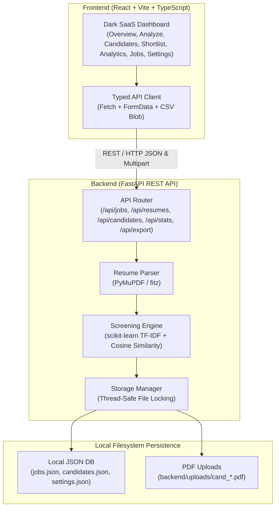

# TalentLens AI — AI-Powered Resume Screening & Candidate Ranking Platform

[](https://www.python.org/)
[](https://fastapi.tiangolo.com/)
[](https://scikit-learn.org/)
[](https://react.dev/)
[](https://www.typescriptlang.org/)
[](https://vitejs.dev/)

**TalentLens AI** is an end-to-end, privacy-first, on-device resume screening and candidate ranking SaaS platform designed for recruiters and engineering hiring managers. Built with a genuine local Machine Learning matching pipeline (**scikit-learn TF-IDF + Cosine Similarity**), local PDF parsing (**PyMuPDF**), thread-safe JSON persistence, and a modern dark SaaS frontend dashboard.

> **Zero Cloud Dependencies**: Runs 100% locally on your machine with **NO API keys**, **NO cloud AI charges** (OpenAI, Gemini, Anthropic), and **NO external databases** (PostgreSQL, MongoDB, Supabase).

---

## 📌 Problem Statement

Traditional resume screening presents critical bottlenecks for hiring teams:
1. **Recruiter Burnout**: Reviewing hundreds of multi-page PDF resumes manually takes hours and leads to inconsistent evaluations.
2. **Opaque "Black-Box" AI**: Cloud LLM screening tools often hallucinate scores, leak private candidate PII to third-party APIs, and fail to provide explainable decision support.
3. **Keyword Stuffing**: Naive regex search misses abbreviations (e.g. `ML` vs `Machine Learning`) while creating false positives (e.g. `C` matching inside `CSS` or `Java` inside `JavaScript`).

**TalentLens AI solves this** by executing an explainable, boundary-safe NLP/ML pipeline locally on the recruiter's system, pairing mathematical TF-IDF text similarity with canonical skill alias normalization.

---

## 🚀 Key Features

- **Local Machine Learning Matching Engine**: Real `TfidfVectorizer` (unigrams + bigrams) and `cosine_similarity` calculating empirical textual alignment against target job descriptions.
- **Explainable Decision Support**: Automatically generates natural language explanations grounded directly in matched and missing skills without fabricated probability claims.
- **Boundary-Safe Skill Normalization**: Comprehensive alias dictionary resolving variants (e.g., `sklearn` $\to$ `scikit-learn`, `k8s` $\to$ `Kubernetes`) while preventing substring contamination (e.g., `C` inside `CSS` or `Java` inside `JavaScript`).
- **PyMuPDF Document Parsing**: High-fidelity text extraction directly from PDF binary streams, handling corrupted files, empty documents, and scanned PDFs with clear warnings.
- **Candidate Information Extraction**: Conservative heuristic extraction for candidate names, regular-expression extraction for emails and phone numbers, and timeline experience estimation.
- **Dynamic Ranking & Multi-Tier Filtering**: Instant search across candidate names, emails, and job benchmarks; filtering by score tiers (Strong $\ge$ 70%, Moderate 40–69%, Lower < 40%) and shortlist status.
- **Multi-File Batch PDF Upload**: Drag-and-drop file staging, pre-upload file validation (PDF header check, 5 MB file size limit, 20 file batch ceiling), and individual file processing.
- **Dedicated Shortlist Workflow**: Filtered review pool for shortlisted talent with aggregated cohort statistics and one-click removal.
- **Backend CSV Export**: Standards-compliant CSV generation with UTF-8 BOM encoding for seamless Microsoft Excel compatibility.
- **Job Benchmark Management**: Role creation and editing with built-in templates (AI/ML Intern, Python Developer, Full-Stack Developer, Data Analyst, Frontend Developer).
- **Synthetic Demo Dataset**: Pre-seeded with 3 realistic candidates (Aria Vance, Liam Chen, Sophia Patel) scored through the real ML pipeline against a sample AI/ML job benchmark.
- **Thread-Safe Local Storage**: JSON persistence with reentrant file locking and automatic cleanup of associated uploaded PDF files upon candidate deletion.

---

## 🏗️ System Architecture



---

## 🧠 Machine Learning Methodology

### 1. Text Normalization
```python
def normalize_text(text: str) -> str:
    # Converts text to lowercase
    # Protects technical tokens with symbols (c++, c#, .net)
    # Normalizes punctuation and collapses extra whitespace
```
- Preserves domain-critical symbols such as `C++`, `C#`, and `.NET`.
- Standardizes vocabulary across diverse resume formatting styles.

### 2. TF-IDF Numerical Vectorization
TalentLens AI fits a `TfidfVectorizer` across both the job description and candidate resume text:
$$\text{TF-IDF}(t, d, D) = \text{TF}(t, d) \times \text{IDF}(t, D)$$
- **N-gram Range**: $(1, 2)$ (capturing unigrams like `python` and bigrams like `machine learning` or `deep learning`).
- **Stop Words**: English stop words removed.
- **Token Pattern**: `(?u)\b\w+\b|c\+\+|c\#|\.net` ensuring programming terms are tokenized intact.

### 3. Cosine Similarity & Clamping
The semantic text alignment between the job benchmark vector $\vec{J}$ and resume vector $\vec{R}$ is calculated as:
$$\text{Similarity}(\vec{J}, \vec{R}) = \frac{\vec{J} \cdot \vec{R}}{\|\vec{J}\|_2 \|\vec{R}\|_2}$$
$$\text{Match Score} = \text{round}\Big(\min(100.0, \max(0.0, \text{Similarity} \times 100.0)), 1\Big)$$

### 4. Boundary-Safe Skill Alignment & Coverage
Skills are matched using boundary-safe regex patterns and an alias dictionary:
$$\text{Required Skill Coverage} = \frac{|\text{Required Skills Matched}|}{|\text{Total Required Skills}|} \times 100\%$$
- **Aliases**: `sklearn` $\leftrightarrow$ `scikit-learn`, `k8s` $\leftrightarrow$ `kubernetes`, `js` $\leftrightarrow$ `javascript`.
- **False Positive Prevention**: Strict word boundaries prevent `C` from triggering on `CSS` and `Java` from triggering on `JavaScript`.

### 5. Ethical Decision-Support Notice
> **Statutory Notice**: Match scores are decision-support signals based on technical vocabulary overlap and skill matching. They are **not hiring probabilities** and should never be used as the sole basis for employment decisions.

---

## 📁 Project Structure

```text
TalentLens-AI/
├── backend/
│   ├── app/
│   │   ├── __init__.py
│   │   ├── main.py                 # FastAPI application & lifespan management
│   │   ├── models.py               # Pydantic v2 schemas
│   │   ├── storage.py              # Local JSON & file cleanup operations
│   │   ├── resume_parser.py        # PyMuPDF text & contact extraction
│   │   ├── screening_engine.py     # scikit-learn TF-IDF & skill matching
│   │   ├── demo_generator.py       # Synthetic candidate generator
│   │   └── routes/
│   │       ├── __init__.py
│   │       ├── health.py           # /api/health
│   │       ├── stats.py            # /api/stats
│   │       ├── jobs.py             # /api/jobs
│   │       ├── resumes.py          # /api/resumes/upload
│   │       ├── candidates.py       # /api/candidates
│   │       ├── export.py           # /api/export/csv
│   │       ├── demo.py             # /api/demo/reset & clear
│   │       └── settings.py         # /api/settings
│   ├── data/
│   │   ├── .gitkeep
│   │   ├── jobs.json               # Persisted job descriptions
│   │   ├── candidates.json         # Persisted candidate analyses
│   │   └── settings.json           # Application preferences
│   ├── uploads/
│   │   └── .gitkeep                # Stored candidate PDF resumes
│   ├── tests/
│   │   ├── __init__.py
│   │   └── test_core.py            # Complete backend test suite
│   ├── pytest.ini
│   └── requirements.txt
├── frontend/
│   ├── src/
│   │   ├── components/
│   │   │   ├── Sidebar.tsx         # Collapsible desktop & mobile drawer
│   │   │   ├── Header.tsx          # Top bar with job selector & health indicator
│   │   │   ├── CandidateDetailModal.tsx # Dossier modal with text viewer
│   │   │   └── JobModal.tsx        # Role creation & template loader
│   │   ├── pages/
│   │   │   ├── OverviewPage.tsx    # KPIs, Recharts graphs, recent activity
│   │   │   ├── AnalyzePage.tsx     # Multi-PDF upload & live results table
│   │   │   ├── CandidatesPage.tsx  # Searchable, filterable candidate directory
│   │   │   ├── ShortlistPage.tsx   # Curated talent shortlist
│   │   │   ├── AnalyticsPage.tsx   # Distributions & skill telemetry
│   │   │   ├── JobsPage.tsx        # Job benchmark management
│   │   │   └── SettingsPage.tsx    # Privacy disclosures & thresholds
│   │   ├── services/
│   │   │   └── api.ts              # Typed API service module
│   │   ├── types/
│   │   │   └── index.ts            # TypeScript interfaces
│   │   ├── App.tsx                 # Root application controller
│   │   ├── main.tsx
│   │   └── index.css               # Modern dark SaaS design system
│   ├── index.html
│   ├── package.json
│   ├── tsconfig.json
│   └── vite.config.ts
├── .gitignore
└── README.md
```

---

## 🛠️ Prerequisites

- **Python 3.11+** installed (`python --version`)
- **Node.js v18+** & **npm v9+** installed (`node -v`, `npm -v`)
- Modern web browser (Chrome, Edge, Firefox, Safari)

---

## ⚙️ Installation & Setup

### 1. Backend Setup

```bash
# Navigate to the backend directory
cd backend

# Create a virtual environment
python -m venv .venv

# Activate virtual environment
# On Windows PowerShell:
.venv\Scripts\Activate.ps1
# On Windows CMD:
.venv\Scripts\activate.bat
# On macOS/Linux:
source .venv/bin/activate

# Install required dependencies
pip install -r requirements.txt
```

### 2. Frontend Setup

```bash
# Navigate to the frontend directory
cd ../frontend

# Install dependencies
npm install
```

---

## 🚀 Running the Application

Open two terminal windows to run both servers locally:

### Terminal 1: FastAPI Backend
```bash
cd backend
.venv\Scripts\python.exe -m uvicorn app.main:app --host 127.0.0.1 --port 8000 --reload
```

### Terminal 2: Vite React Frontend
```bash
cd frontend
npm run dev -- --host 127.0.0.1 --port 5173
```

---

## 🌐 Local URLs

| Service | URL | Description |
| :--- | :--- | :--- |
| **Frontend UI** | [http://localhost:5173](http://localhost:5173) | Modern Dark SaaS Dashboard |
| **Backend API Root** | [http://localhost:8000](http://localhost:8000) | FastAPI Base Service |
| **Swagger UI Docs** | [http://localhost:8000/docs](http://localhost:8000/docs) | Interactive API Explorer |
| **ReDoc API Docs** | [http://localhost:8000/redoc](http://localhost:8000/redoc) | Detailed Schema Docs |
| **Health Check** | [http://localhost:8000/api/health](http://localhost:8000/api/health) | System & ML Library Diagnostics |

---

## 🧪 Testing Backend Workflows

The test suite thoroughly verifies:
1. Health endpoint & ML library availability
2. Job creation, validation of missing fields, updates, and deletion
3. In-memory PDF text extraction & heuristic contact identification
4. Handling of empty, corrupted, and scanned/blank PDFs without text
5. Real TF-IDF cosine similarity calculations (high vs low alignment)
6. Boundary-safe skill matching with aliases (e.g. `C` does not match `CSS`)
7. Multi-PDF resume upload endpoint, per-file error isolation, and shortlist toggle
8. Safe deletion of candidate records and uploaded disk files
9. CSV export generation with valid UTF-8 BOM encoding
10. Demo dataset resets without deleting real candidate uploads

Execute tests using `pytest`:
```bash
cd backend
.venv\Scripts\python.exe -m pytest tests/test_core.py -v
```

Expected output:
```text
tests/test_core.py::test_health_endpoint PASSED                          [ 14%]
tests/test_core.py::test_job_crud_and_validation PASSED                  [ 28%]
tests/test_core.py::test_pdf_extraction_and_heuristics PASSED            [ 42%]
tests/test_core.py::test_invalid_and_empty_pdf_handling PASSED           [ 57%]
tests/test_core.py::test_tfidf_and_skill_matching PASSED                 [ 71%]
tests/test_core.py::test_resume_upload_endpoint PASSED                   [ 85%]
tests/test_core.py::test_demo_reset_preserves_real_records PASSED        [100%]

======================== 7 passed in 2.35s =========================
```

---

## 📡 API Endpoint Reference

| Method | Endpoint | Description |
| :--- | :--- | :--- |
| `GET` | `/api/health` | Service status & scikit-learn / PyMuPDF versions |
| `GET` | `/api/stats` | Computed dashboard KPIs, distributions, top skills |
| `GET` | `/api/jobs` | List all saved job benchmarks |
| `POST` | `/api/jobs` | Create a job benchmark with required & preferred skills |
| `GET` | `/api/jobs/{id}` | Retrieve specific job details |
| `PUT` | `/api/jobs/{id}` | Update job benchmark fields |
| `DELETE` | `/api/jobs/{id}` | Delete job benchmark |
| `GET` | `/api/jobs/templates` | Retrieve pre-built role templates |
| `POST` | `/api/resumes/upload` | Multi-PDF upload with PyMuPDF extraction & ML screening |
| `GET` | `/api/candidates` | List candidates with search, score tiers, and sorting |
| `GET` | `/api/candidates/{id}` | Complete candidate details and extracted text |
| `PATCH` | `/api/candidates/{id}/shortlist` | Toggle shortlist status |
| `DELETE` | `/api/candidates/{id}` | Delete candidate record & disk file |
| `GET` | `/api/export/csv` | Downloadable CSV export with UTF-8 BOM |
| `POST` | `/api/demo/reset` | Refresh synthetic demo dataset without deleting real uploads |
| `DELETE` | `/api/demo/clear` | Remove demo candidates while keeping real uploads |
| `GET` | `/api/settings` | Retrieve storage paths, thresholds, and privacy notices |
| `PATCH` | `/api/settings` | Update score tier thresholds |

---

## 🔒 Privacy & Storage Architecture

- **Local Processing**: PDFs are parsed using PyMuPDF and vectorized with scikit-learn locally on CPU. No data leaves the computer.
- **Local JSON Persistence**: Application state is stored in `backend/data/jobs.json`, `candidates.json`, and `settings.json`.
- **Upload Storage**: Original PDF files are stored in `backend/uploads/` using sanitized server-side filenames (`cand_<uuid>.pdf`). User filenames are never used as raw filesystem paths.
- **File Cleanup**: Deleting a candidate record safely removes its corresponding physical PDF file from the `uploads/` directory.
- **Caution**: Local JSON storage is unencrypted by default. The application is designed for local decision support and should not be exposed over public networks without HTTPS/TLS and authentication.

---

## 🎤 How to Demo in an Internship Interview

When presenting this project in an AI/ML, Python, or Full-Stack engineering interview, follow this structured walkthrough:

1. **Architecture & Design Philosophy (1 Minute)**
   - Explain that TalentLens AI is an on-device, privacy-preserving resume screening platform that uses a genuine scikit-learn ML pipeline without external API dependencies or hardcoded scores.
   - Point out the clean separation between the FastAPI backend and React TypeScript frontend.

2. **Overview Dashboard & Dynamic Metrics (1 Minute)**
   - Show the KPI cards: Total Uploads, Screened Candidates, Shortlisted Talent, Average Score, and Highest Score.
   - Highlight that every metric and Recharts graph is calculated directly from persisted records. Point out the clearly labeled "DEMO DATA ACTIVE" pill.

3. **Job Benchmark Management (1 Minute)**
   - Navigate to **Job Descriptions** and click **+ Create New Role**.
   - Click a quick-fill template like **Full-Stack Developer** or **AI/ML Intern** to demonstrate how role requirements and skill dictionaries are defined.

4. **PDF Upload & Live ML Screening (2 Minutes)**
   - Navigate to **Analyze Resumes**.
   - Drag and drop or browse sample PDF resumes.
   - Explain how PyMuPDF extracts text streams, validates PDF headers, enforces the 5 MB file size limit, and catches unreadable/scanned PDFs with clear feedback.
   - Show the live screening table displaying the calculated TF-IDF cosine similarity percentage.

5. **Explainability & Candidate Dossier (2 Minutes)**
   - Navigate to **Candidates**.
   - Show the dynamic ranking (`#1`, `#2`, `#3`), score tier badges, and search filter.
   - Open a candidate modal:
     - Show the **TF-IDF Cosine Similarity** bar and **Required Skill Coverage** gauge.
     - Review the **Machine Learning Analysis Summary** showing grounded, rule-based explanations.
     - Demonstrate the **Extracted Resume Text** viewer accordion.
     - Toggle the candidate's **Shortlist** status and show that it reflects immediately on the dedicated **Shortlist** page and in the **CSV Export**.

6. **Engineering Rigor & Testing (1 Minute)**
   - Highlight the Pytest suite verifying boundary checks (e.g., `C` not matching `CSS`), upload error isolation, and thread-safe persistence.

---

## ⚖️ Limitations & Future Improvements

- **No OCR in MVP**: Scanned image PDFs without selectable text return an informative message. Future improvement: integrate local Tesseract OCR or EasyOCR.
- **Single-Node Storage**: JSON storage is thread-safe via reentrant locks but intended for local workstation usage. Future improvement: optional local SQLite/DuckDB engine for large cohorts.
- **Advanced Embeddings**: The current engine uses TF-IDF n-grams for fast, explainable, lightweight CPU inference. Future improvement: optional local Sentence-Transformers (`all-MiniLM-L6-v2`) via ONNX Runtime for semantic embeddings.

---

## 📄 License

Developed for educational and portfolio demonstration purposes. All rights reserved.
